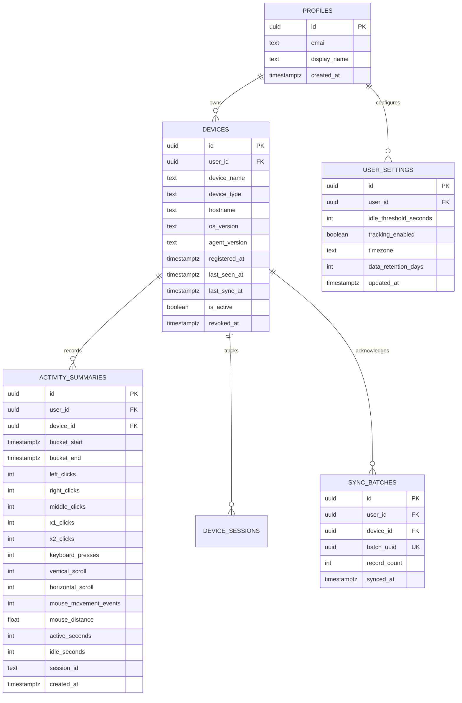

# Project PULSE — Database Architecture & Schema Specification

## 1. Cloud PostgreSQL / Supabase Schema

The cloud database is partitioned and isolated strictly by authenticated user through PostgreSQL Row Level Security (RLS).

### Entity Relationship Diagram (Mermaid)



---

## 2. Row Level Security (RLS) Implementation

Every table has RLS enabled. Users can only select, insert, or modify records where `auth.uid() = user_id`.

```sql
-- Enforces that input can only be uploaded from active, non-revoked devices owned by the authenticated user
CREATE POLICY "Users can insert own activity summaries"
    ON public.activity_summaries FOR INSERT
    WITH CHECK (
        auth.uid() = user_id AND
        EXISTS (
            SELECT 1 FROM public.devices
            WHERE devices.id = activity_summaries.device_id
              AND devices.user_id = auth.uid()
              AND devices.is_active = true
              AND devices.revoked_at IS NULL
        )
    );
```

---

## 3. Local SQLite Schema

Stored on each device at `%LOCALAPPDATA%\ProjectPulse\pulse.db`.

1. `local_device`: Local registration state, device UUID, device name, and heartbeat.
2. `activity_summaries`: 60-second quantized aggregations with unique constraint `(device_id, bucket_start)` and `is_synced` flag.
3. `sync_queue`: Transient queue for retrying batches.
4. `application_settings`: Key-value storage for encrypted tokens, endpoints, and thresholds.
5. `agent_logs`: Internal diagnostic logs with timestamp and severity.
